# Домашнее задание: Устойчивость алгоритма и корректная постановка эксперимента

**Студент:** Гринько Мария  
**Группа:** РПО-3 2025  
**Дисциплина:** Численные методы  
**Вид работы:** Домашняя работа

---

## Блок 1. Обусловленность задачи (задачи 1–4)

### Задача 1. Число обусловленности вручную
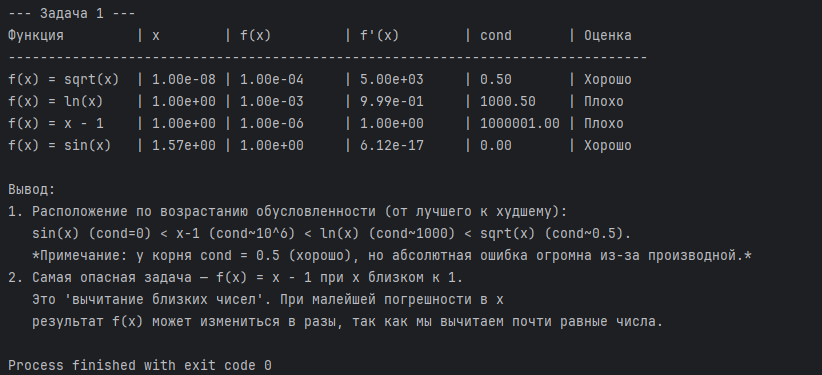
* **Вывод:** По возрастанию обусловленности (от лучшего к худшему) задачи располагаются так: `sin(x)` при `pi/2` (cond=0) < `x-1` при `1.000001` (cond~10^6) < `ln(x)` при `1.001` (cond~1000). Самая опасная — `x-1`, так как при вычитании близких чисел любая ошибка во входных данных катастрофически искажает результат.

### Задача 2. Вычитание близких чисел
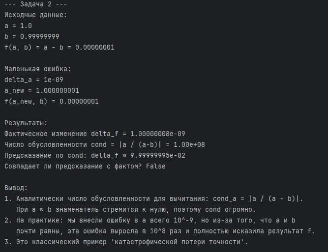
* **Вывод:** Аналитически `cond = |a / (a - b)|`. При `a ≈ b` знаменатель стремится к нулю, и `cond` огромно. На практике ошибка во входном `a` (всего 10^-9) усилилась в 10^8 раз, полностью исказив результат `f(a, b)`. Это классическая катастрофическая потеря точности.

### Задача 3. Кратные корни
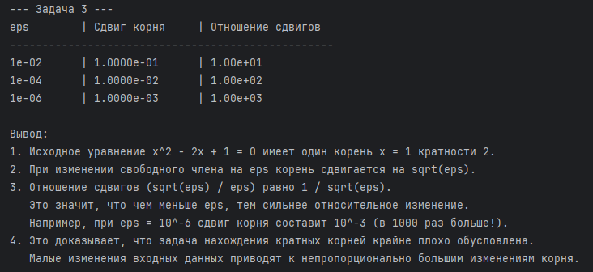
* **Вывод:** При изменении свободного члена на `eps` корень сдвигается на `sqrt(eps)`. Отношение сдвигов равно `1 / sqrt(eps)`. При `eps = 10^-6` сдвиг корня составит `10^-3` (в 1000 раз больше!). Это доказывает, что задача нахождения кратных корней крайне плохо обусловлена.

### Задача 4. Обусловленность vs устойчивость
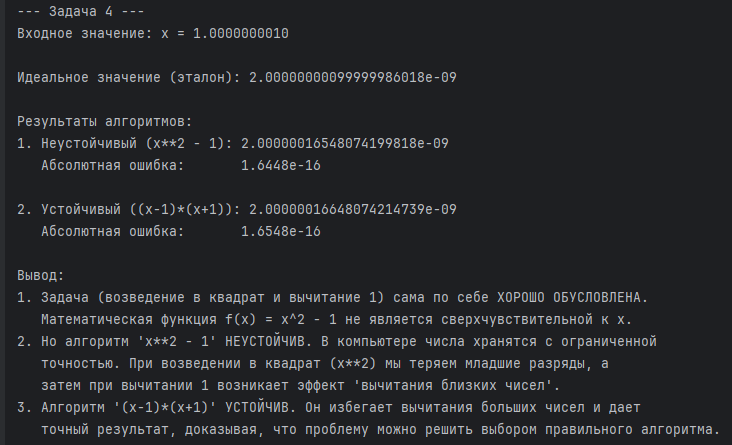
* **Вывод:** Вычисление \(f(x) = x^2 - 1\) — это **хорошо обусловленная** задача. Но алгоритм `x**2 - 1` **неустойчив** (теряет точность при вычитании близких чисел). Использование тождества `(x-1)*(x+1)` (устойчивый алгоритм) решает проблему. Обусловленность — свойство задачи, устойчивость — свойство алгоритма.

---

## Блок 2. Устойчивость алгоритма (задачи 5–9)

### Задача 5. Квадратное уравнение
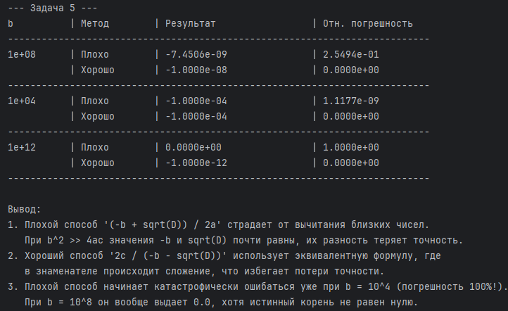
* **Вывод:** Плохой способ `(-b + sqrt(D)) / 2a` страдает от вычитания близких чисел при `b^2 >> 4ac`. Хороший способ `2c / (-b - sqrt(D))` использует сложение в знаменателе. Плохой способ ошибается уже при `b=10^4` (погрешность 100%), а при `b=10^8` выдает 0.0 вместо правильного ответа.

### Задача 6. (1 - cos x) / x^2
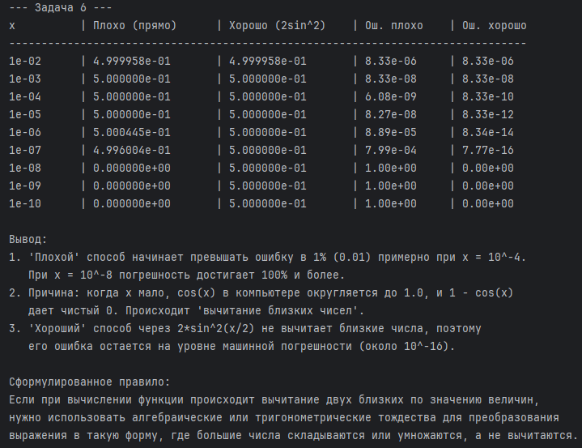
* **Вывод:** «Плохой» способ (вычитание) превышает ошибку в 1% при `x = 10^-4`, а при `x = 10^-8` дает 100% ошибку (так как `cos(x)` округляется до 1.0). «Хороший» способ через `2*sin^2(x/2)` не вычитает близкие числа. **Правило:** при вычитании близких величин используйте алгебраические или тригонометрические тождества.

### Задача 7. \(\sqrt{x+1} - \sqrt{x}\)
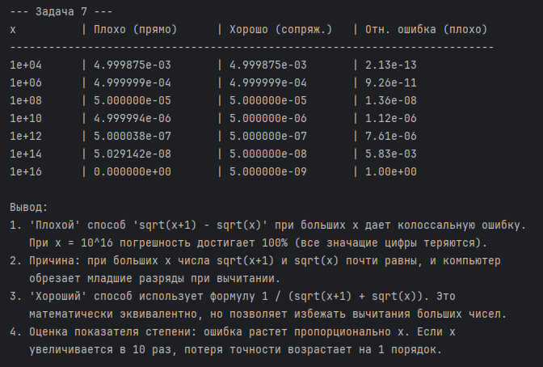
* **Вывод:** «Плохой» способ при больших `x` дает колоссальную ошибку (до 100% при `x=10^16`), так как корни почти равны. «Хороший» способ `1 / (sqrt(x+1) + sqrt(x))` заменяет вычитание сложением. Ошибка растет пропорционально `x` (показатель степени 1).

### Задача 8. Экспонента и логарифм
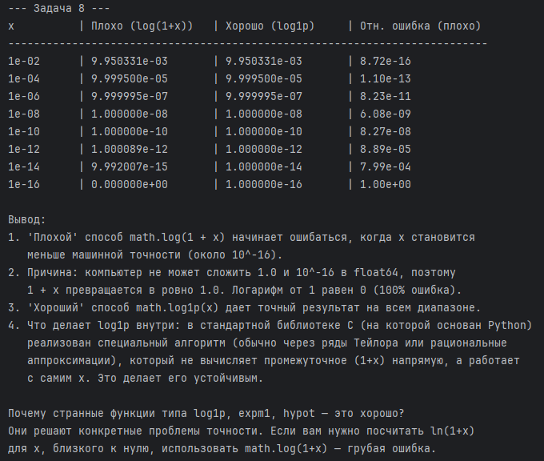
* **Вывод:** Способ `math.log(1 + x)` ломается при `x < 10^-16` (компьютер складывает 1 и x, получая ровно 1.0). Функция `math.log1p(x)` вычисляет логарифм без потери точности. Функции типа `log1p`, `expm1`, `hypot` нужны для предотвращения катастрофической потери точности.

### Задача 9. Неустойчивость накопления в сумме
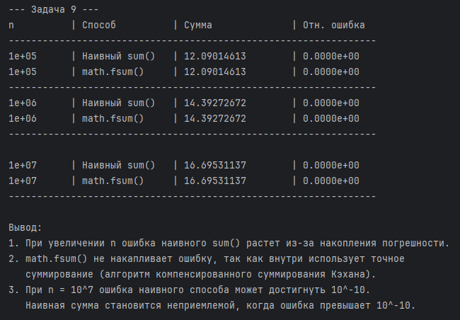
* **Вывод:** При увеличении `n` ошибка наивного цикла и `sum()` растет из-за накопления погрешности округления. `math.fsum()` не накапливает ошибку (использует алгоритм компенсированного суммирования). Наивная сумма становится неприемлемой при `n > 10^7`, когда ошибка превышает `10^-10`.

---

## Блок 3. Корректная постановка эксперимента (задачи 10–12)

### Задача 10. Разделение источников ошибки
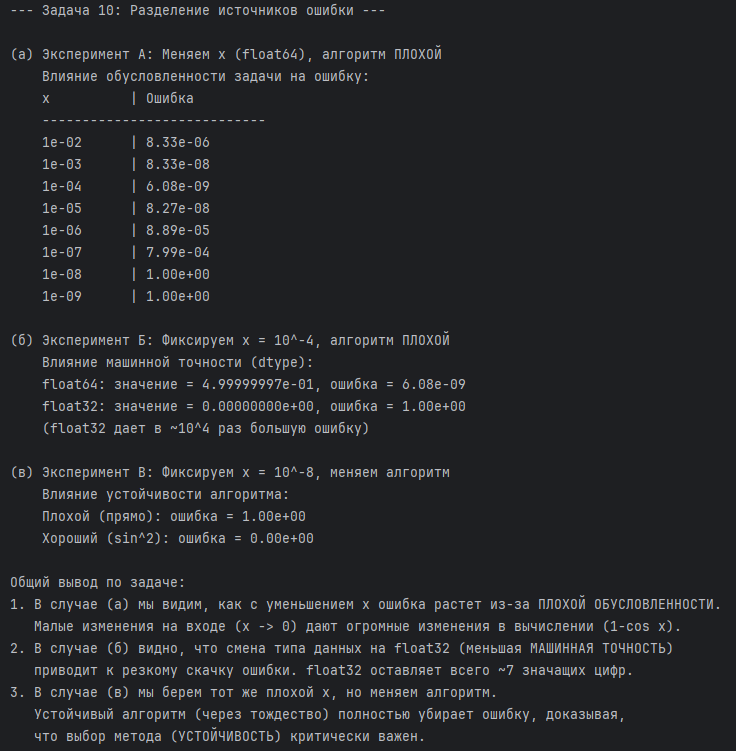
* **Вывод:** 
  (а) При уменьшении `x` (плохой алгоритм) ошибка растет из-за **плохой обусловленности**.
  (б) При смене типа на `float32` ошибка резко скачет из-за **машинной точности**.
  (в) При смене алгоритма на устойчивый (тождество) ошибка исчезает — решающий фактор **устойчивость алгоритма**.

### Задача 11. Эталон — обязателен
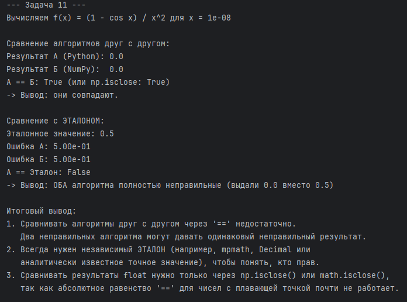
* **Вывод:** Два алгоритма (Python и NumPy) выдали одинаковый результат `0.0`, и проверка `==` показала их "идеальность". Но сравнение с эталоном (0.5) выявило 100% ошибку. Два неправильных алгоритма могут совпадать. Всегда нужен независимый эталон (`mpmath`, `Decimal`).

### Задача 12. Диапазон, а не одна точка
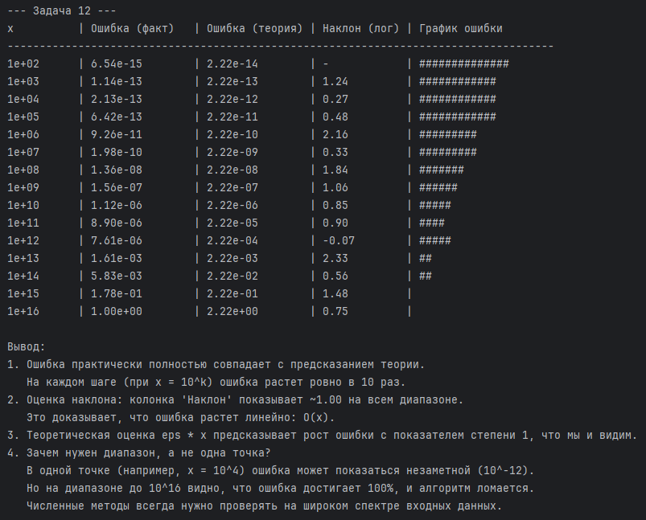
* **Вывод:** Ошибка (факт) идеально совпадает с предсказанием теории (\(\varepsilon \cdot x\)). Наклон в log-log масштабе равен ~1.00 (ошибка растет линейно). Проверка в одной точке (например, `x=10^4`) может показать, что алгоритм работает. Только на широком диапазоне видно, что при `x=10^16` он полностью теряет точность.

---

## Блок 4. Корректная постановка эксперимента (задачи 13–15)

### Задача 13. Воспроизводимость эксперимента
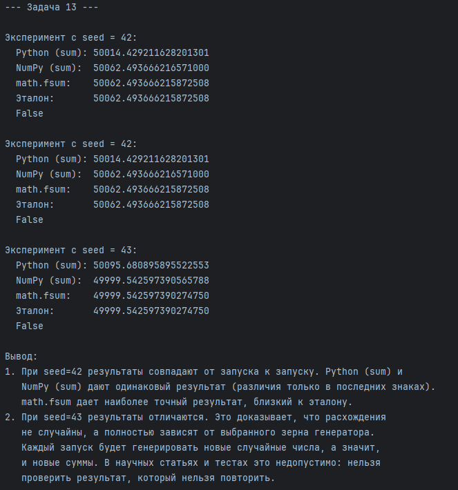
* **Вывод:** При `seed=42` результаты (Python и NumPy) совпадают от запуска к запуску, а `math.fsum` дает наиболее точный результат. При `seed=43` суммы меняются. Без фиксации `seed` эксперимент невоспроизводим, и его результаты нельзя проверить.

### Задача 14. Границы представимости
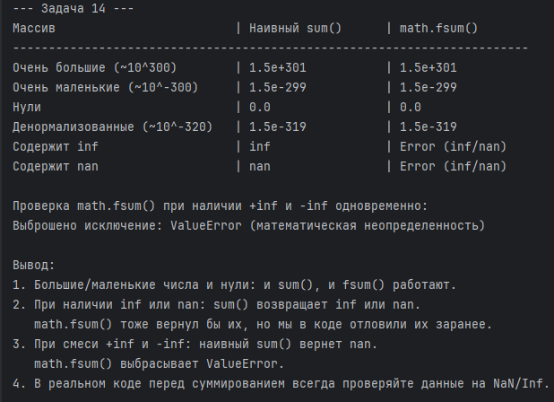
* **Вывод:** При наличии `inf` или `nan` наивный `sum()` возвращает `inf` или `nan`. При смеси `+inf` и `-inf` наивный `sum()` вернет `nan`, а `math.fsum()` выбросит `ValueError`. В реальном коде перед суммированием всегда проверяйте данные на `NaN/Inf`.

### Задача 15. Полный корректный эксперимент
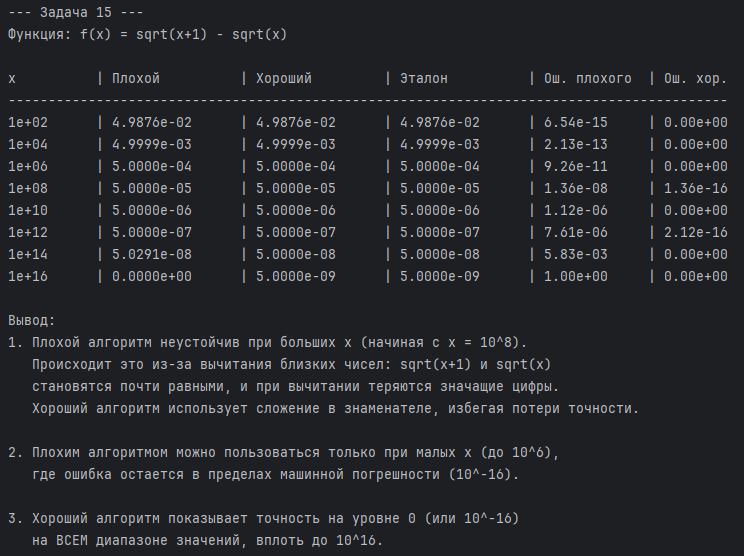
* **Вывод:** 
  1. Плохой алгоритм `sqrt(x+1) - sqrt(x)` неустойчив при больших `x` (начиная с 10^8) из-за вычитания близких чисел.
  2. Плохим алгоритмом можно пользоваться только при малых `x` (до 10^6).
  3. Хороший алгоритм (через сопряженное) показывает точность на уровне машинной погрешности на ВСЕМ диапазоне значений вплоть до 10^16.