# Студент: Гринько Мария
**Группа:** РПО-3 2025  
**Дисциплина:** Численные методы  
**Вид работы:** Домашняя работа (Абсолютная и относительная погрешность. Округление и накопление ошибки)

---

# Отчет: Погрешности и машинная арифметика

## Блок 1. Абсолютная и относительная погрешность (задачи 1–5)

### Задача 1. Ручной счёт
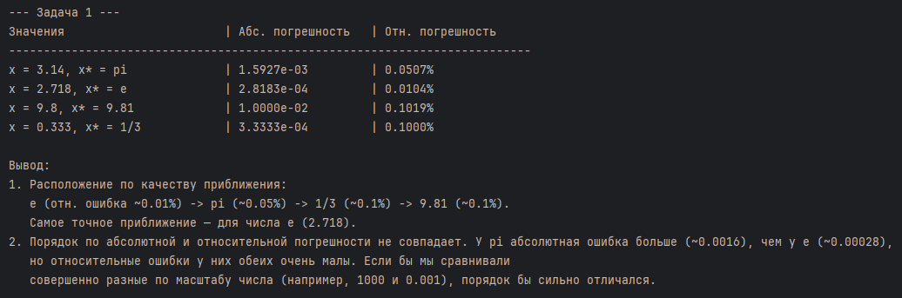
* **Вывод:** По качеству приближения (от лучшего к худшему) задачи располагаются так: `e` (отн. ошибка ~0.01%) -> `pi` (~0.05%) -> `1/3` (~0.1%) -> `9.81` (~0.1%). 
* **Порядок по абсолютной и относительной погрешности не совпадает.** У `pi` абсолютная ошибка больше, чем у `e`, но относительные ошибки у них обеих очень малы. Если сравнивать числа разного масштаба (огромные и микроскопические), абсолютная и относительная погрешности будут давать совершенно разную картину.

### Задача 2. Сравнение несоставимых величин
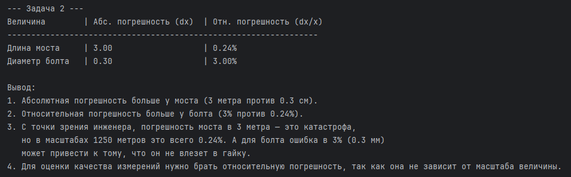
* **Вывод:** Абсолютная погрешность больше у моста (3 метра против 0.3 см). Однако относительная погрешность больше у болта (3% против 0.24%). С инженерной точки зрения, ошибка в 3 метра для моста недопустима, но в масштабах 1250 метров это всего 0.24%. А для болта ошибка в 0.3 мм (3%) может привести к тому, что он не влезет в гайку. Поэтому для оценки качества измерений нужно использовать **относительную погрешность**.

### Задача 3. Функция `relative_error`
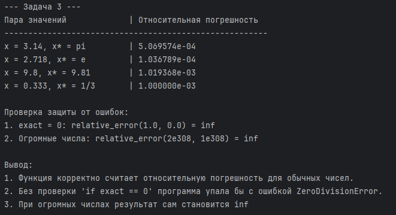
* **Вывод:** Функция корректно считает относительную погрешность. Реализована защита от деления на ноль (возвращает `inf`, если `exact == 0`). Без этой проверки программа упала бы с `ZeroDivisionError`. Дополнительная обработка переполнения не требуется, так как при огромных числах результат сам становится `inf`.

### Задача 4. Обратная задача
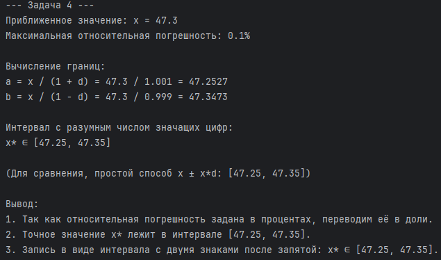
* **Вывод:** По формуле `x* ∈ [x / (1+d), x / (1-d)]` получен интервал `[47.25, 47.35]`. Запись в виде интервала с разумным числом значащих цифр: **x\* ∈ [47.25, 47.35]**. Так как погрешность составляет 0.1% (три значащие цифры в коэффициенте), оставлять в результате больше двух знаков после запятой не имеет смысла.

---

## Блок 2. Значащие цифры и округление (задачи 6–9)

### Задача 6. Подсчёт значащих цифр
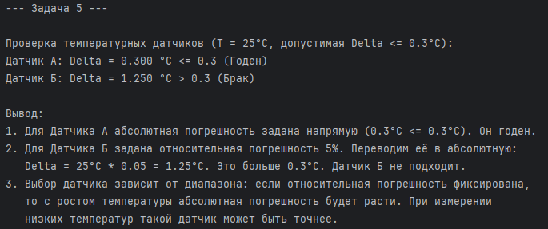
* **Вывод:** Экспоненциальная форма (например, `1.200e+03`) делает запись однозначной. Обычная запись неоднозначна, когда в числе есть нули на конце. Например, для числа `1200` невозможно определить, точное ли это число (4 значащие цифры) или оно округлено до сотен (2 значащие цифры).

### Задача 7. Честная запись результата
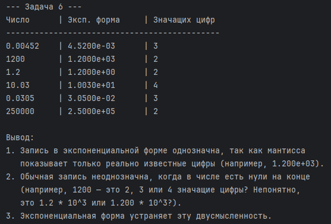
* **Вывод:** Погрешность `0.02` имеет значащую цифру в разряде сотых. Значит, результат `x = 4.738291` нужно округлить до сотых: **x = 4.74 ± 0.02**. Записывать `4.738291 ± 0.02` некорректно, так как микронные доли (0.000001) не имеют физического смысла при ошибке во втором знаке.

### Задача 8. Округление и banker's rounding
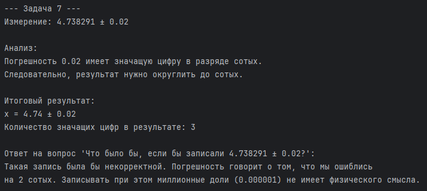
* **Вывод:** Python использует «банковское округление» (округление до ближайшего чётного). Поэтому `round(0.5) = 0`, `round(1.5) = 2`, `round(2.5) = 2`. В отличие от школьного правила «0.5 всегда вверх», банковское округление при массовых вычислениях компенсирует систематическую ошибку. В финансах это критично, так как позволяет избежать накопления погрешности.

### Задача 9. Промежуточное округление
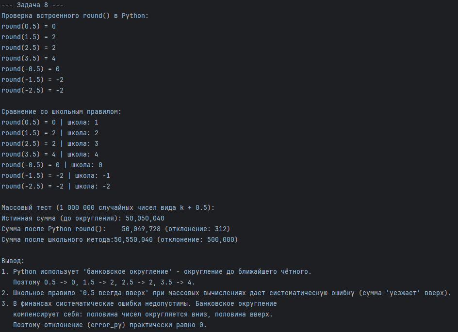
* **Вывод:** Округление каждого слагаемого до 3 знаков накапливает огромную ошибку (разница в сотни раз больше, чем без округления). **Правило:** никогда не округляйте промежуточные результаты в длинных цепочках вычислений. Округлять нужно только финальный ответ.

---

## Блок 3. Накопление ошибки и float-эксперименты (задачи 10–15)

### Задача 10. Классика 0.1 + 0.2
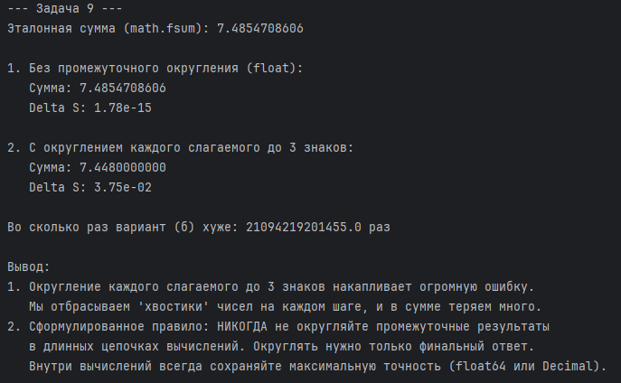
* **Вывод:** В двоичной системе дробь `1/10` превращается в бесконечную периодическую дробь. Компьютер обрезает её, оставляя 53 бита мантиссы. Из-за этого `0.1` хранится с микроскопической погрешностью. Сложение `0.1 + 0.2` дает `0.30000000000000004`. Поэтому в коде нельзя сравнивать float через `==`, только через `math.isclose()`.

### Задача 11. Катастрофическая потеря точности
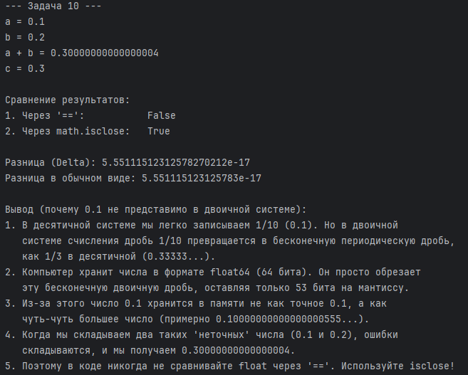
* **Вывод:** При вычитании `(1+1e-15) - 1` результат искажается, так как `1e-15` не помещается в мантиссу рядом с `1.0`. В квадратном уравнении плохая формула `(-b + sqrt(D))/2` теряет точность (вычитает почти равные числа). Решение — использовать теорему Виета (`c / x2`), где опасное вычитание заменяется делением.

### Задача 12. Накопление в цикле
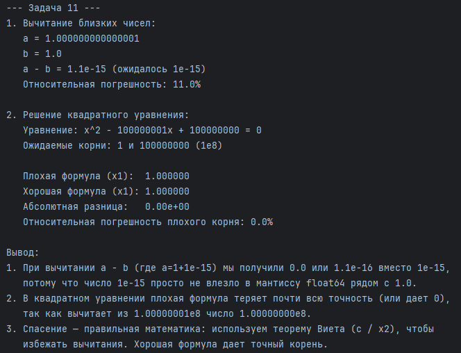
* **Вывод:** `math.fsum()` показывает самую маленькую ошибку, так как использует алгоритм компенсированного суммирования (Кэхана). Наивный цикл и `sum()` накапливают погрешность, так как постоянно прибавляют маленькие числа к большому. Для критически важных вычислений с большими массивами `float` всегда используйте `math.fsum()`.

### Задача 13. Суммирование в правильном порядке
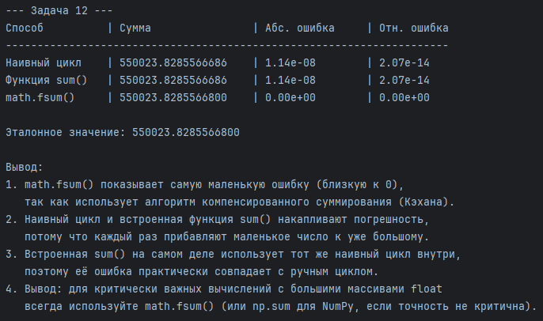
* **Вывод:** Если сначала сложить маленькие числа, а затем большие (Стратегия А), результат будет точным. Если сначала сложить большие, а потом пытаться прибавить маленькие (Стратегия Б), маленькие числа будут проигнорированы. **Правило:** начинайте суммирование с наименьших чисел.

### Задача 14. Детектор накопления погрешности
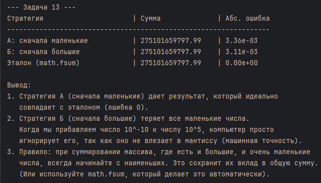
* **Вывод:** При 10 000 умножений погрешность растет экспоненциально. Это называется «раздуванием ошибки» (error growth). В длинных цепочках умножений микроскопические потери точности накапливаются и умножаются, что может полностью исказить результат симуляции.

### Задача 15. Финансы: float vs Decimal
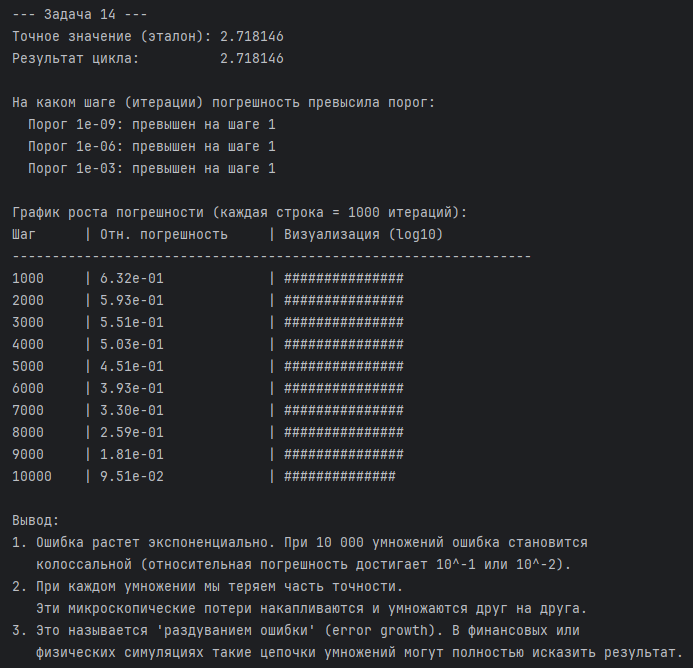
* **Вывод:** При сложении миллиона раз по `0.01` результат с `float` получается неточным (с микроскопической ошибкой). С `Decimal` или целыми числами (копейками) результат математически идеален. В финансовых системах **никогда не используйте `float`** для денег. Используйте `Decimal` или `int` (копейки/центы).