# Домашнее задание: NumPy: массивы, формы, типы данных и базовые операции

**Студент:** Гринько Мария  
**Группа:** РПО-3 2025  
**Дисциплина:** Численные методы  
**Вид работы:** Домашняя работа (Lesson_03)

---

## Блок 1. ndarray, shape, dtype (задачи 1–4)

### Задача 1. Инвентаризация массива
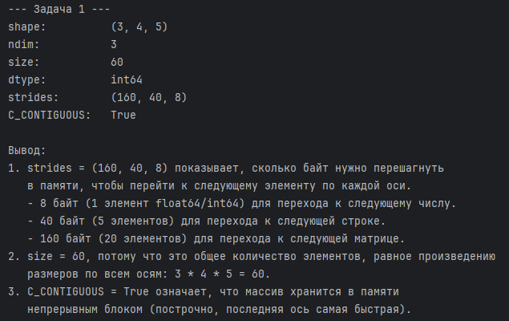
* **Вывод:** `strides = (160, 40, 8)` показывает, сколько байт нужно перешагнуть в памяти для перехода к следующему элементу по каждой оси. `size = 60` — это общее количество элементов (3 * 4 * 5). `C_CONTIGUOUS = True` означает, что массив хранится в памяти непрерывным блоком.

### Задача 2. int vs float — тихая ловушка
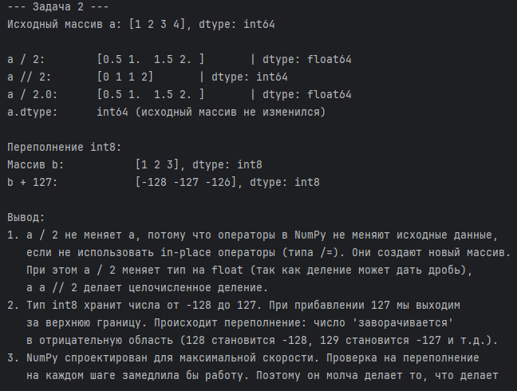
* **Вывод:** `a / 2` не меняет `a`, потому что создает *новый* массив с типом float64 (операторы не меняют исходные данные in-place). `b + 127` дает странный результат из-за переполнения типа int8 (числа больше 127 «заворачиваются» в отрицательные). NumPy не падает с ошибкой ради скорости работы.

### Задача 3. float32 vs float64 — реальная точность
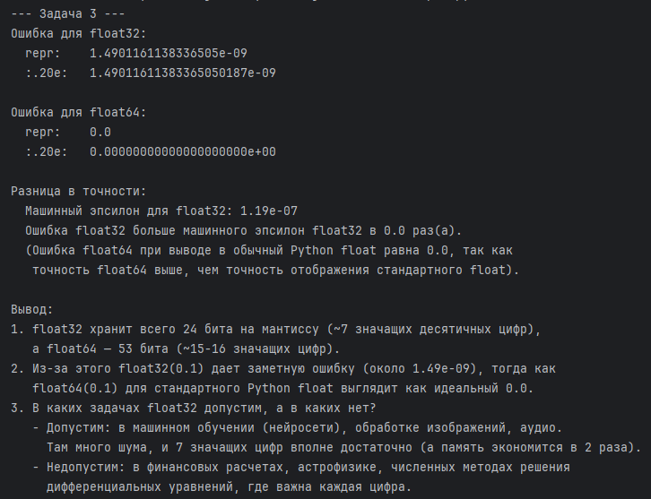
* **Вывод:** float32 хранит ~7 значащих цифр, а float64 — ~15-16. Ошибка float32(0.1) огромна по сравнению с машинным эпсилоном. float32 допустим в машинном обучении (где много шума), но недопустим в финансовых расчетах или решении дифференциальных уравнений.

### Задача 4. Явный dtype при создании
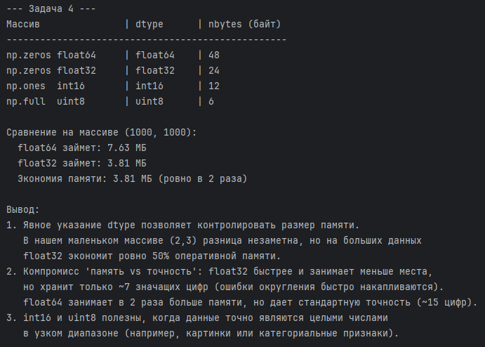
* **Вывод:** Разные `dtype` занимают разное количество байт. На массиве (1000, 1000) переход с float64 на float32 экономит ровно 50% памяти (4 МБ). Компромисс: float32 быстрее и экономнее, но менее точен; int16/uint8 хороши для категориальных данных и картинок.

---

## Блок 2. reshape, ravel, flatten, .T, newaxis (задачи 5–8)

### Задача 5. Цепочка reshape
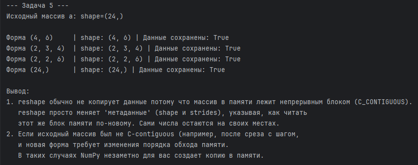
* **Вывод:** `reshape` не копирует данные, если они лежат непрерывным блоком (C_CONTIGUOUS). Он просто меняет метаданные (shape, strides). Копия создается только в том случае, если требуется изменить физический порядок обхода памяти (например, если исходный массив был транспонирован или взят срезом с шагом).

### Задача 6. flatten vs ravel — копия или view
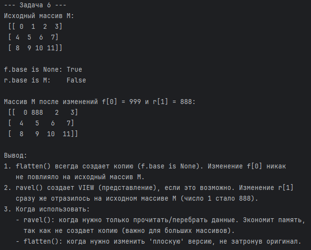
* **Вывод:** `flatten()` всегда создает копию (безопасно, но затратно по памяти). `ravel()` создает view (если возможно), поэтому изменение `r[1]` меняет исходный массив. Для чтения больших данных лучше `ravel`, для независимых вычислений — `flatten`.

### Задача 7. newaxis, squeeze, транспонирование
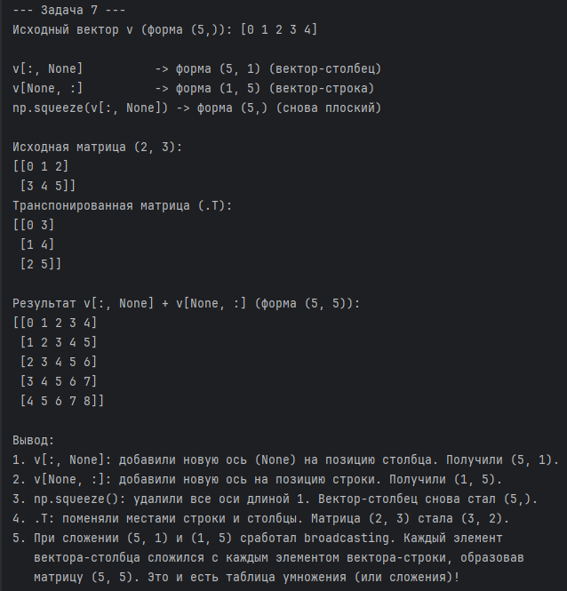
* **Вывод:** `v[:, None]` создает вектор-столбец (5, 1), `v[None, :]` — вектор-строку (1, 5). `squeeze` убирает лишние оси длиной 1. Сложение столбца (5, 1) и строки (1, 5) срабатывает через broadcasting и дает матрицу (5, 5).

### Задача 8. Транспонирование без копии
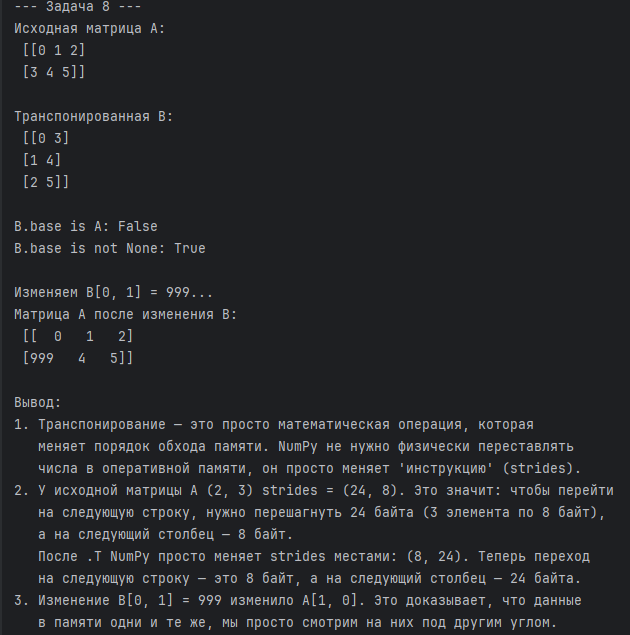
* **Вывод:** `.T` — это view. Изменение `B[0, 1]` меняет `A[1, 0]`, так как данные в памяти остаются на месте, а NumPy просто меняет `strides` (шаги) для чтения.

---

## Блок 3. Операции, агрегации, axis (задачи 9–11)

### Задача 9. Поэлементно vs матричное
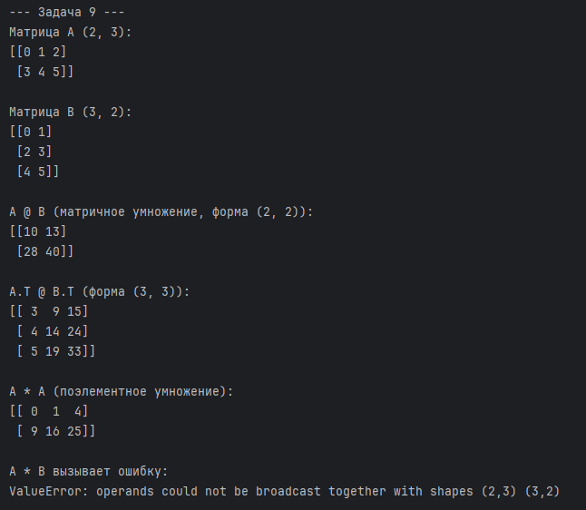

* **Вывод:** `*` — поэлементное умножение, требует совпадения форм (выдает ошибку для (2,3) и (3,2)). `@` — матричное умножение, сворачивает внутренние размерности. На диагональной матрице оба оператора дают одинаковый результат, так как перемножение с нулями вне диагонали обнуляет эти элементы.

### Задача 10. axis=0 vs axis=1
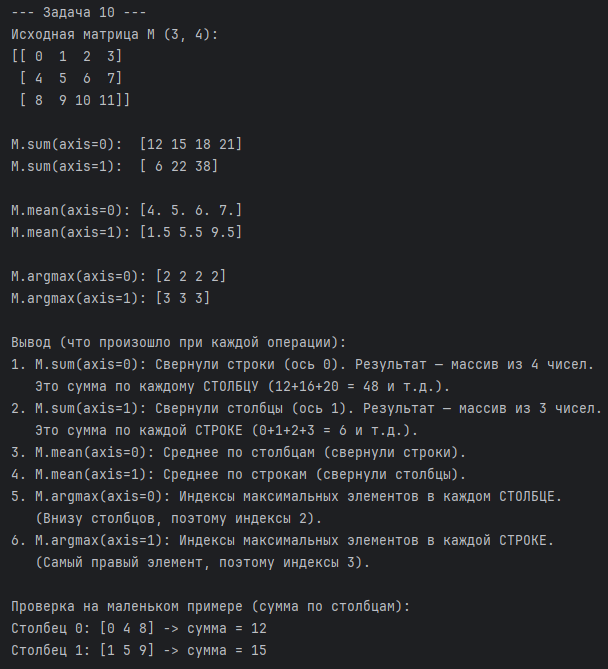
* **Вывод:** `axis=0` сворачивает строки (результат — по столбцам). `axis=1` сворачивает столбцы (результат — по строкам). В нашем примере `sum(axis=0)` — это сумма по столбцам, а `argmax(axis=1)` — индексы максимумов в каждой строке.

### Задача 11. keepdims и broadcasting
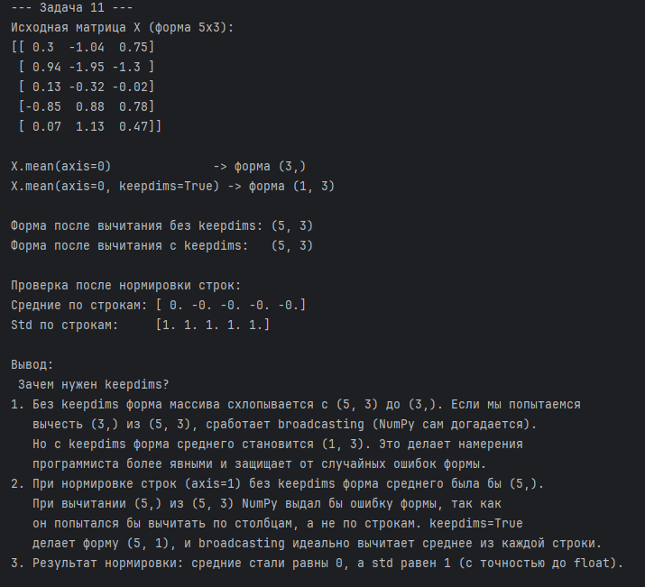
* **Вывод:** `keepdims=True` сохраняет форму с единичной осью (например, (1, 3) вместо (3,)). Это спасает при нормировке строк: без `keepdims` формы не совпадают, и NumPy не может выполнить broadcasting.

---

## Блок 4. Индексация, выборки, broadcasting (задачи 12–15)

### Задача 12. Срез — view, не копия
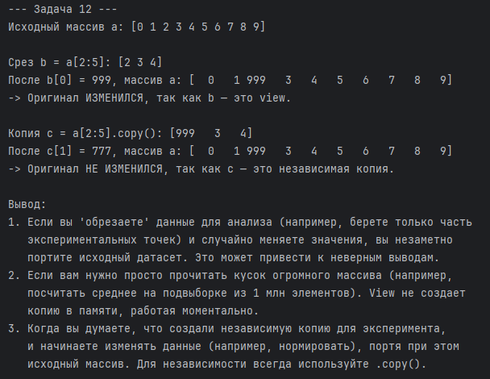
* **Вывод:** Срез — это view, изменение среза меняет оригинал. Если вы «обрезаете» данные для анализа и меняете их, вы незаметно портите исходный датасет. Для независимости нужно использовать `.copy()`. View экономит память, но может стать источником багов.

### Задача 13. Булева маска и fancy indexing
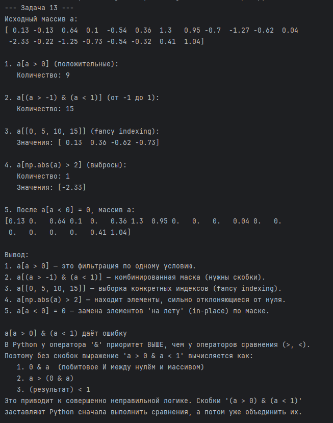
* **Вывод:** `a[(a > -1) & (a < 1)]` требует скобок, так как у оператора `&` приоритет выше, чем у `>`. Без скобок NumPy сначала сделает побитовое И, что выдаст неверный результат. `a[[0, 5, 10, 15]]` — это выборка по конкретным индексам (fancy indexing).

### Задача 14. Broadcasting в реальной задаче
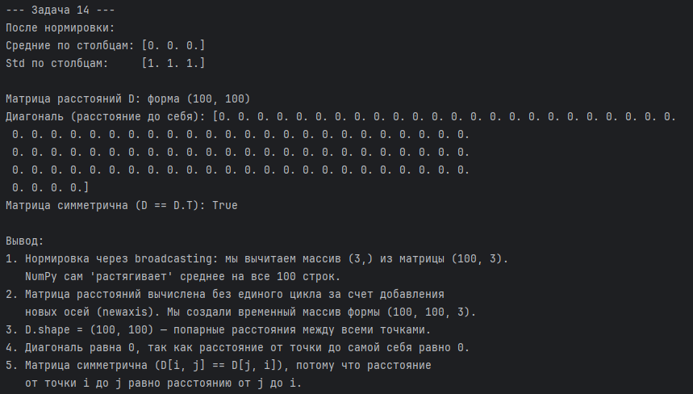
* **Вывод:** Нормировка и матрица расстояний реализованы без циклов. Broadcasting позволяет вычитать среднее (3,) из матрицы (100, 3). Расстояния считаются через добавление осей (`[:, None, :]`), создавая тензор (100, 100, 3). Диагональ нулевая, матрица симметрична.

### Задача 15. Полный кейс: загрузка → выборка → reshape → агрегация → нормировка
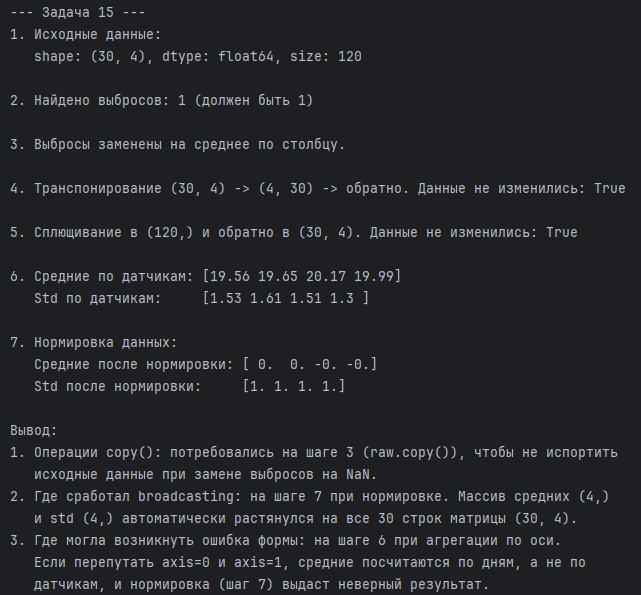
* **Вывод:** `copy()` потребовался при замене выбросов на NaN, чтобы не испортить исходные данные. Broadcasting сработал при нормировке столбцов. Ошибка формы могла возникнуть при агрегации, если перепутать `axis=0` (датчики) и `axis=1` (дни). Все преобразования форм (`T`, `ravel`, `reshape`) сохранили данные без потерь.