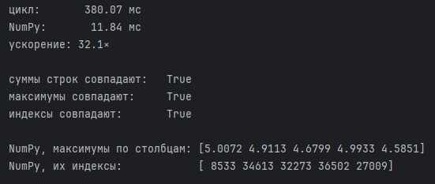

# Lesson 04: Сравнение производительности циклов Python и NumPy

**Студент:** Гринько Мария  
**Группа:** РПО-3 2025  
**Дисциплина:** Численные методы

---

## Задача: Сумма по строкам и максимумы (цикл vs NumPy)

**Условие:** 
Дан массив `m` формы `(200 000, 5)` — 200 000 строк по 5 чисел. Нужно посчитать сумму каждой строки (результат — массив из 200 000 чисел) и максимум каждого столбца вместе с его индексом. Сравнить реализацию на чистых циклах Python и на векторизованных функциях NumPy, замерив время выполнения.

**Что сделано:**
1. **Способ 1 (циклы):** Написан вложенный цикл `for` для прохода по каждому элементу матрицы (для сумм) и циклы для поиска максимального значения и его индекса в каждом столбце.
2. **Способ 2 (NumPy):** Использованы векторизованные функции `mat.sum(axis=1)`, `mat.max(axis=0)` и `mat.argmax(axis=0)`.
3. **Замер времени:** Обе функции запущены по 3 раза (с выбором лучшего времени) с помощью `time.perf_counter()`.

**Результаты замеров:**
* Время выполнения с циклами: **380.07 мс**
* Время выполнения с NumPy: **11.84 мс**
* **Ускорение:** **32.1×**

**Вывод:**
NumPy работает более чем в 30 раз быстрее, потому что операции выполняются на уровне скомпилированного C-кода, а не интерпретатором Python. Все проверки (`np.allclose` и `np.array_equal`) показали `True`, что доказывает: векторизованные операции дают абсолютно идентичный математический результат, но при этом экономят колоссальное количество времени при обработке больших массивов данных.