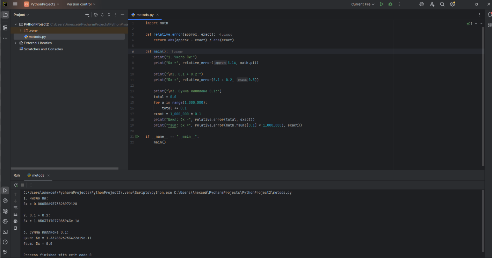

# Практическая работа 01: Оценка погрешности вычислений

**Студент:** Гринько Мария  
**Группа:** РПО-3 2025  
**Дисциплина:** Численные методы  
**Вид работы:** Практика 01

---

## Цель работы
На практике познакомиться с понятиями абсолютной и относительной погрешности. Реализовать функцию для вычисления относительной погрешности и продемонстрировать её работу на классических примерах накопления ошибок с плавающей точкой (float).

## Выполнение работы

Была реализована функция `relative_error(approx, exact)`, возвращающая относительную погрешность по формуле: \(\delta x = \frac{|approx - exact|}{|exact|}\).

С помощью этой функции были проверены три кейса, описанных в теоретическом материале:

1. **Число Пи:**
   Сравнили приближение `3.14` с точным значением `math.pi`.
   *Полученная погрешность:* `0.0005069573828972128` (около 0.05%). Это показывает, что 3.14 — довольно хорошее приближение.

2. **Классика `0.1 + 0.2`:**
   Сравнили результат сложения `0.1 + 0.2` с ожидаемым `0.3`.
   *Полученная погрешность:* `1.8503717077085943e-16`. 
   Хотя `0.1 + 0.2 == 0.3` выдает `False` из-за особенностей двоичного представления чисел, относительная погрешность показывает, что расхождение находится на уровне машинного нуля (порядка \(10^{-16}\)). Это доказывает, что сравнивать числа с плавающей точкой через `==` нельзя, нужны допуски.

3. **Сумма миллиона `0.1`:**
   Сравнили два способа суммирования: наивный цикл `for` и функцию `math.fsum`.
   * Наивный цикл: погрешность составила `1.3328826753422619e-11`.
   * `math.fsum`: погрешность составила `0.0`.
   Этот эксперимент наглядно показывает **накопление ошибки**. При многократном сложении в цикле ошибка округления накапливается. Функция `math.fsum` использует компенсированное суммирование и выдает математически точный результат, полностью устраняя погрешность.

## Вывод
В ходе практики было подтверждено, что числа с плавающей точкой (float) имеют ограниченную точность, и при массовых вычислениях (например, в длинных циклах) ошибки имеют свойство накапливаться. Для критически важных вычислений необходимо использовать специальные алгоритмы суммирования (`math.fsum`) или типы данных с повышенной точностью (`Decimal`). Также было усвоено, что сравнивать float напрямую нельзя.