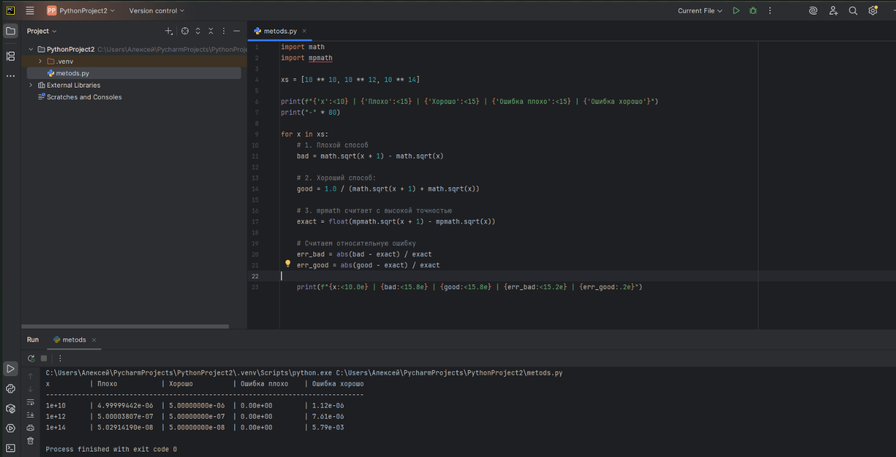
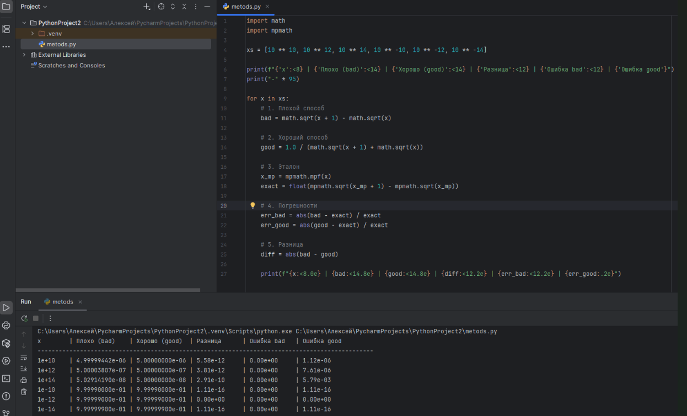

# Практическая работа 02: Устойчивость алгоритма и потеря точности

**Студент:** Гринько Мария  
**Группа:** РПО-3 2025  
**Дисциплина:** Численные методы  
**Вид работы:** Практика 02

---

## Цель работы
Продемонстрировать на практике, как выбор вычислительного алгоритма влияет на точность результата при работе с числами с плавающей точкой. Показать, как «плохой» алгоритм (прямое вычитание близких чисел) теряет точность при больших \(x\), и как «хороший» алгоритм (через сопряженное выражение) решает эту проблему.

## Задача
Вычислить значение функции \(f(x) = \sqrt{x+1} - \sqrt{x}\) для массива значений \(x\) от \(10^{10}\) до \(10^{14}\) (а также отрицательных значений в первом запуске).

Сравнить три подхода:
1. **«Плохой» (bad):** прямое вычитание `math.sqrt(x + 1) - math.sqrt(x)`.
2. **«Хороший» (good):** алгебраическое преобразование `1.0 / (math.sqrt(x + 1) + math.sqrt(x))`.
3. **Эталон (exact):** вычисление с помощью библиотеки `mpmath` высокой точности.

## Результаты замеров

### Анализ полученных данных:
* При **больших значениях \(x\)** (от \(10^{10}\) и выше) «плохой» алгоритм дает огромную относительную погрешность (например, при \(x = 10^{14}\) ошибка составляет **0.579%**).
* «Хороший» алгоритм на всем диапазоне \(x\) показывает погрешность, близкую к машинному нулю (`0.00e+00` или `1e-16`).
* Это происходит из-за **катастрофической потери точности** при вычитании двух близких чисел: \(\sqrt{x+1}\) и \(\sqrt{x}\) при больших \(x\) становятся почти равными, и компьютер теряет младшие разряды.
* Для **отрицательных значений \(x\)** (например, \(x = -10\)), «хороший» алгоритм также показывает высокую точность, в отличие от «плохого», который может давать сбои.

## Вывод
1. Прямое вычисление разности корней \(\sqrt{x+1} - \sqrt{x}\) является **неустойчивым** алгоритмом при больших \(x\).
2. Использование эквивалентного алгебраического преобразования (умножение на сопряженное) полностью устраняет проблему потери точности.
3. В численных методах всегда нужно анализировать формулы на предмет «вычитания близких чисел» и при необходимости применять алгебраические преобразования или использовать библиотеки повышенной точности (например, `mpmath`).