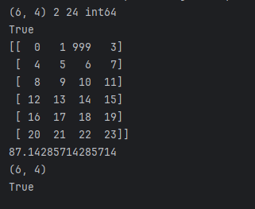

# Практическая работа 03: Базовые операции с массивами NumPy

**Студент:** Гринько Мария  
**Группа:** РПО-3 2025  
**Дисциплина:** Численные методы  
**Вид работы:** Практика 03 (Мини-упражнение)

---

## Выполнение мини-упражнения

* **Пункт 1 (Создание массива):** Создан массив формы `(6, 4)` из `np.arange(24)`. Выведены атрибуты: `shape = (6, 4)`, `ndim = 2`, `size = 24`, `dtype = int64`. 
* **Пункт 2 (Перестройка формы):** Массив успешно перестроен в `(4, 6)`, затем в `(2, 3, 4)` и обратно в `(24,)`. Проверка через `np.array_equal` показала `True`, что доказывает: `reshape` меняет только метаданные, а сами данные остаются неизменными.
* **Пункт 3 (Срезы):** Срез `arr[:, 2]` является **view** (представлением), а не копией. После изменения `col_slice[0] = 999` это значение сразу отразилось в оригинальном массиве в первой строке (элемент `2` стал `999`).
* **Пункт 4 (Булева маска):** С помощью фильтрации `arr[arr > 10]` отобраны элементы больше 10. Их среднее значение составило `87.14285714285714`.
* **Пункт 5 (Broadcasting):** Вычитание среднего по строкам реализовано через `axis=1, keepdims=True`. Благодаря этому форма массива сохранилась `(6, 4)`, и проверка `np.allclose(row_sums, 0)` подтвердила (`True`), что сумма элементов в каждой строке после центрирования равна нулю.