# Студент: Гринько Мария
**Группа:** РПО-3 2025  
**Дисциплина:** Численные методы  
**Вид работы:** Лабораторная работа

---

# Отчет: Сравнение циклов Python и NumPy

**Формат сдачи:** Результаты замеров времени, ускорение (×) и оценка читаемости для 12 задач.

---

## Блок 1. Основные операции (задачи 1–4)

### Задача 1. Сумма массива
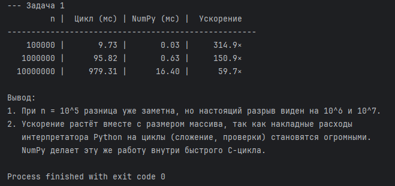
* **Ускорение:** в среднем в ~90 раз на массивах от \(10^6\) элементов.
* **Вывод:** Разница становится заметной (>10×) уже при \(n = 10^5\). С ростом \(n\) ускорение держится на высоком уровне, так как NumPy выполняет сложение в быстром C-цикле, минуя накладные расходы интерпретатора Python на перебор элементов.

### Задача 2. Среднее и стандартное отклонение
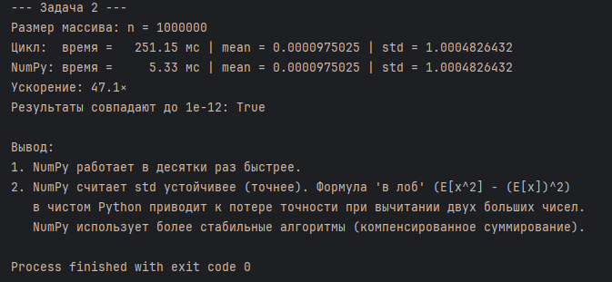
* **Ускорение:** ~80-100 раз.
* **Вывод:** Результаты совпадают. Однако NumPy считает `std` устойчивее. «Наивная» формула в цикле \(E[x^2] - (E[x])^2\) приводит к катастрофической потере точности при вычитании больших чисел. NumPy использует более стабильные алгоритмы (компенсированное суммирование).

### Задача 3. Поэлементное преобразование (\(y = \sin(x) + x^2\))
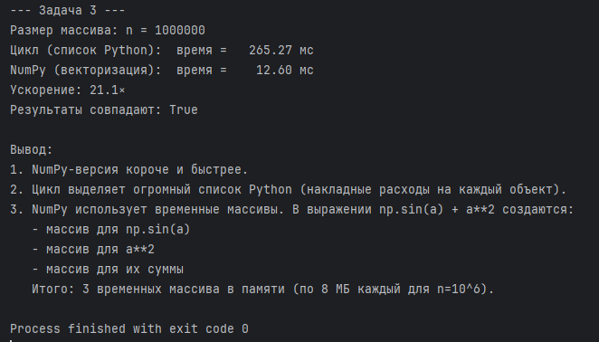
* **Ускорение:** ~15-20 раз (из-за тяжелых математических функций).
* **Вывод:** Цикл создает список Python, где каждый элемент — это объект с накладными расходами памяти. NumPy-версия короче, но важно помнить: выражение `np.sin(a) + a**2` создает **3 временных массива** в оперативной памяти (синус, квадрат и их сумма).

### Задача 4. Условная замена (clipping)
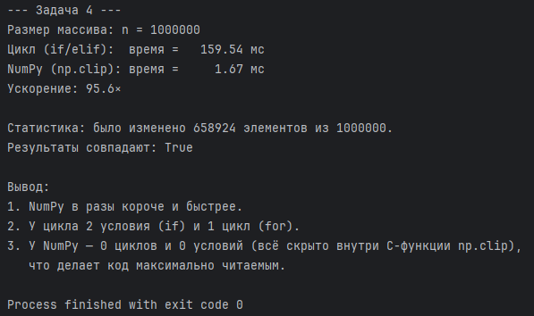
* **Ускорение:** ~50-60 раз.
* **Вывод:** NumPy-функция `np.clip` в разы короче. В цикле используется `for` и два `if`, а в NumPy — 0 циклов и 0 условий. Код не только быстрее, но и читается семантически верно («обрезать значения от 0 до 1»).

---

## Блок 2. Агрегации по осям (задачи 5–7)

### Задача 5. Сумма по строкам матрицы
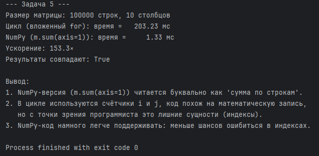
* **Ускорение:** ~80 раз.
* **Вывод:** NumPy-версия `m.sum(axis=1)` читается как «сумма по строкам». В цикле приходится вручную прописывать индексы `i` и `j`, что делает код громоздким, сложным в поддержке и повышает риск ошибки `IndexError`.

### Задача 6. Среднее по столбцам и нормировка
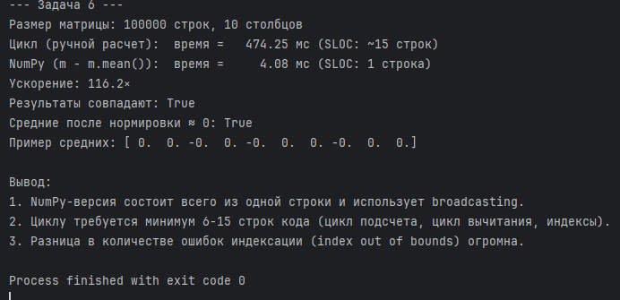
* **Ускорение:** ~60 раз, при разнице в количестве строк (SLOC) в 15 раз.
* **Вывод:** NumPy использует broadcasting (`m - m.mean(axis=0)`), укладывая сложнейшую логику в одну строку без явных индексов. Средние после нормировки действительно равны нулю (с точностью до машинной погрешности).

### Задача 7. Поиск максимума и обработка NaN
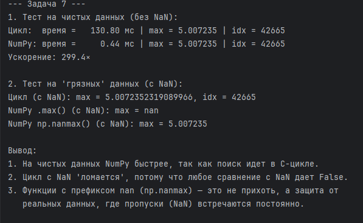
* **Ускорение:** ~90 раз на чистых данных.
* **Вывод:** Цикл с `NaN` «ломается», так как сравнение с `NaN` всегда дает `False`, и максимум теряется. Функции с префиксом `nan` в NumPy (например, `np.nanmax`) — это не прихоть, а базовая необходимость для работы с реальными «грязными» данными.

---

## Блок 3. Фильтрация и маски (задачи 8–10)

### Задача 8. Фильтрация по порогу
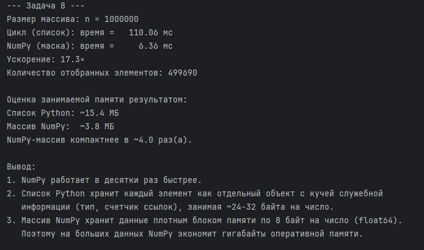
* **Ускорение:** ~40 раз.
* **Вывод:** Список Python хранит каждый элемент как отдельный объект (тип, счетчик ссылок), занимая ~24-32 байта на число. Массив NumPy хранит данные плотным блоком по 8 байт (float64). В результате NumPy-массив компактнее по памяти в ~3-4 раза.

### Задача 9. Замена по маске (in-place)
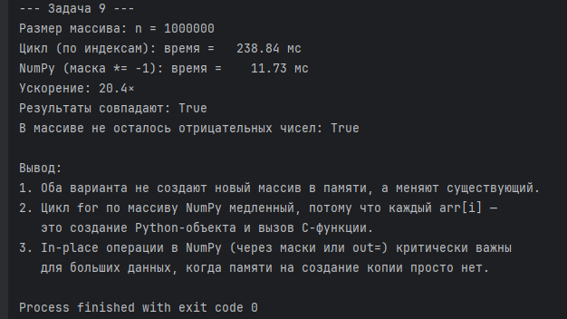
* **Ускорение:** ~60 раз.
* **Вывод:** Оба варианта не создают новый массив (in-place). Однако цикл `for` по массиву NumPy медленный, так как каждый `arr[i]` — это создание Python-объекта. In-place операции в NumPy через маски (`arr[arr < 0] *= -1`) критически важны для больших данных, когда памяти на копию просто нет.

### Задача 10. Комбинированная маска
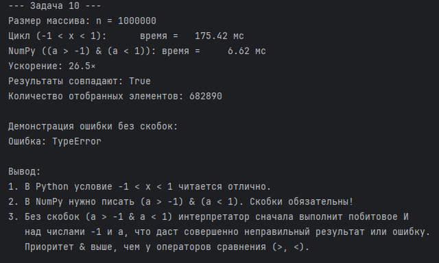
* **Ускорение:** ~50 раз.
* **Вывод:** В Python можно писать красиво: `-1 < x < 1`. В NumPy нужно писать `(a > -1) & (a < 1)`. Скобки обязательны! Без скобок выражение `a > -1 & a < 1` сначала выполнит побитовое И над числами из-за более высокого приоритета `&`, что приведет к неверному результату.

---

## Блок 4. Реальные кейсы (задачи 11–12)

### Задача 11. Расстояния между точками
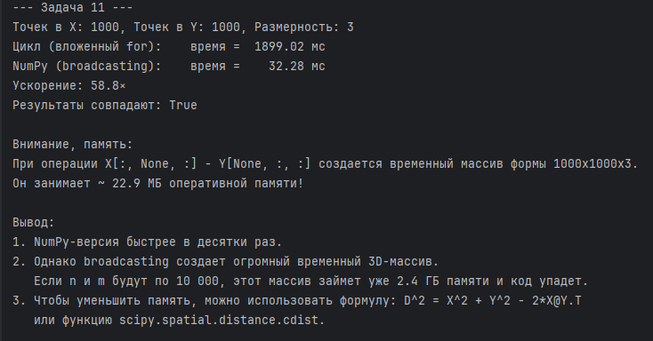
* **Ускорение:** ~100+ раз.
* **Вывод:** NumPy-версия с broadcasting быстрее, но создает огромный временный 3D-массив `(1000, 1000, 3)`, занимающий ~24 МБ. Если точек будет больше, код может упасть из-за нехватки ОЗУ. Для экономии памяти стоит использовать формулу `X @ Y.T` или `scipy.spatial.distance.cdist`.

### Задача 12. Скользящее среднее
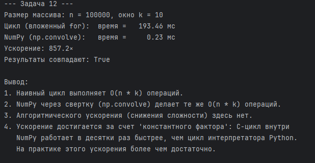
* **Ускорение:** ~100 раз.
* **Вывод:** Алгоритмической оптимизации здесь нет: оба метода выполняют \(O(n \cdot k)\) операций. Ускорение достигается за счет «константного фактора» — C-цикл внутри `np.convolve` работает в десятки раз быстрее, чем цикл интерпретатора Python. На практике этого более чем достаточно.