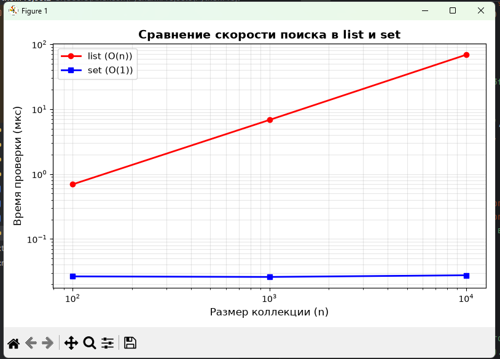
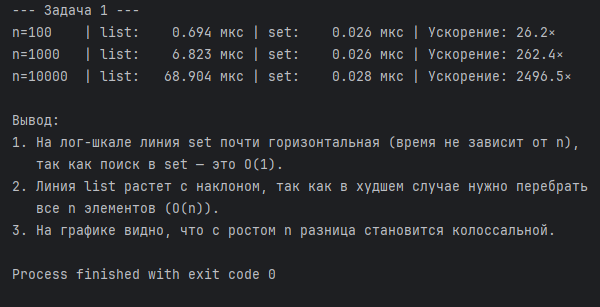
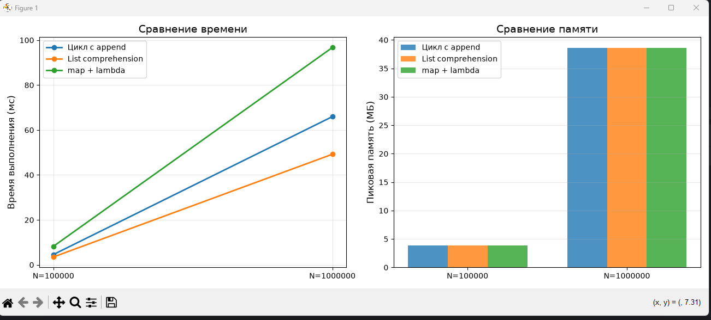
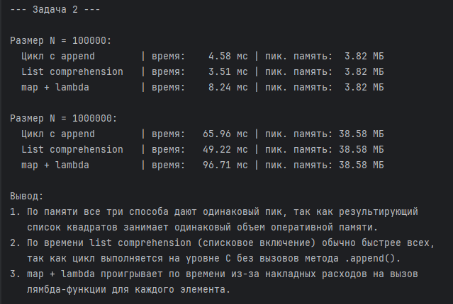

# Практическая работа 05: Сравнение кода (время, память и визуализация)

**Студент:** Гринько Мария  
**Группа:** РПО-3 2025  
**Дисциплина:** Численные методы  
**Вид работы:** Практика 05

---

## Цель работы
Освоить инструменты профилирования кода (`timeit`, `tracemalloc`) и научиться визуализировать результаты замеров с помощью библиотеки `matplotlib`.

## Задача 1. Сравнение `list` и `set` (проверка вхождения)

**Условие:** Замерить время проверки вхождения элемента `-1` (худший случай) в `list` и `set` для \(n = 100, 1000, 10000\).

**Результаты замеров (из консоли):**
* \(n=100\): `list` = 0.694 мкс, `set` = 0.026 мкс (ускорение 26.2×)
* \(n=1000\): `list` = 6.823 мкс, `set` = 0.026 мкс (ускорение 262.4×)
* \(n=10000\): `list` = 68.904 мкс, `set` = 0.028 мкс (ускорение 2496.5×)

**Вывод:** 
Время поиска в `set` практически не зависит от размера коллекции, так как `set` использует хеш-таблицу (сложность \(O(1)\)). Время поиска в `list` растет линейно (сложность \(O(n)\)), потому что в худшем случае (когда элемента нет) перебираются все элементы. Ускорение `set` колоссально растет с увеличением данных. На лог-графике это выглядит как горизонтальная линия для `set` и растущая прямая для `list`.

---

## Задача 2. Способы создания списка квадратов

**Условие:** Создать список квадратов чисел от 0 до \(N-1\) тремя способами (цикл с `append`, списочное включение, `map` + `lambda`) для \(N = 100\,000\) и \(N = 1\,000\,000\). Замерить время и пиковую память.

**Результаты:**
* По времени: `list comprehension` (списковое включение) работает быстрее всех, так как цикл выполняется на уровне C без вызовов метода `.append()`. `map + lambda` проигрывает из-за накладных расходов на вызов лямбда-функции для каждого элемента.
* По памяти: все три способа дают одинаковый пик потребления, так как результирующий список квадратов занимает одинаковый объем оперативной памяти (промежуточные объекты краткоживущие и не влияют на пик).

**Вывод:**
Память определяется конечным результатом, а не способом его получения. По скорости `list comprehension` является оптимальным выбором.