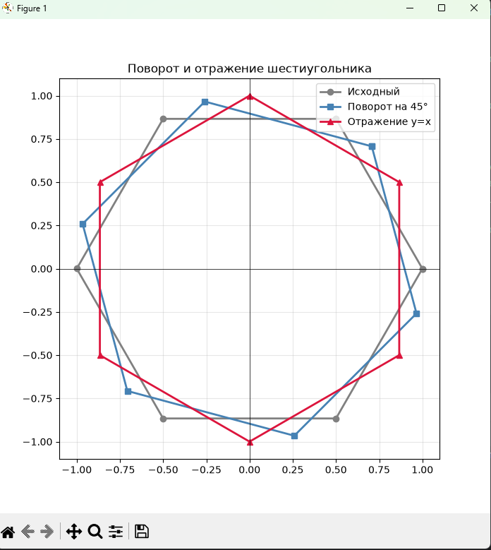
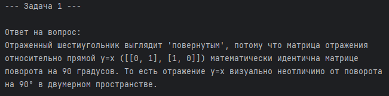
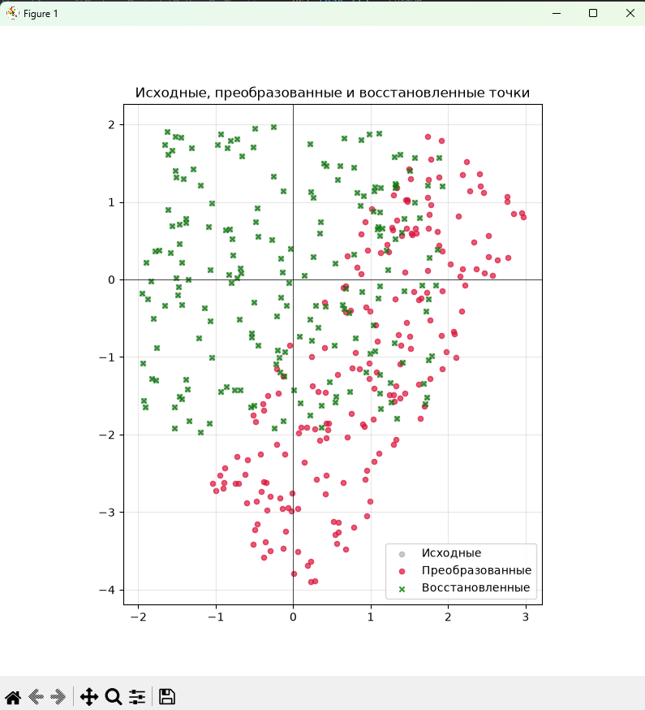
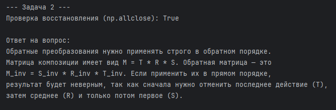

# Практическая работа 06: Матрицы, линейная алгебра и визуализация данных

**Студент:** Гринько Мария  
**Группа:** РПО-3 2025  
**Дисциплина:** Численные методы  
**Вид работы:** Практика 06 (Линейные преобразования)

---

## Задача 1. Поворот и отражение правильного шестиугольника

**Что сделано:** 
Построен правильный шестиугольник с центром в начале координат, заданный через тригонометрические функции. С использованием матриц 2x2 к нему применены два преобразования: поворот на 45° против часовой стрелки и отражение относительно прямой \(y=x\). Оба преобразования, а также исходный контур, отображены на одном графике с сохранением масштаба (`set_aspect('equal')`).

**Ответ на вопрос: почему отраженный шестиугольник выглядит «повернутым»?** 
Отраженный шестиугольник кажется повернутым, потому что матрица отражения относительно прямой \(y = x\) (которая имеет вид \(\begin{pmatrix} 0 & 1 \\ 1 & 0 \end{pmatrix}\)) математически **совпадает** с матрицей поворота на 90 градусов. В двумерном пространстве отражение относительно диагонали визуально эквивалентно повороту на 90°, поэтому фигура выглядит именно так.

---

## Задача 2. Композиция преобразований и обратное преобразование

**Что сделано:** 
Сгенерирован набор из 200 случайных точек (с фиксированным `seed=42`). К точкам применена композиция из трех преобразований в однородных координатах (матрицы 3x3):
1. Масштабирование (\(s_x = 1.5, s_y = 0.5\)).
2. Поворот на 60° против часовой стрелки.
3. Перенос на вектор \((1, -1)\).

Затем исходные точки были восстановлены путем применения обратных преобразований. Проверка через `np.allclose(..., atol=1e-12)` подтвердила, что восстановленные точки идеально совпадают с исходными (на графике зеленые крестики лежат ровно на серых точках).

**Ответ на вопрос: почему обратные преобразования нужно применять в обратном порядке?** 
Обратные преобразования необходимо применять строго в обратном порядке, потому что матрица композиции имеет вид \(M = T \cdot R \cdot S\) (сначала масштаб, потом поворот, потом перенос). Чтобы отменить это действие, нужно сначала отменить последнее действие (перенос, \(T^{-1}\)), затем среднее (поворот, \(R^{-1}\)) и только потом первое (масштаб, \(S^{-1}\)). Итоговая обратная матрица имеет вид \(M^{-1} = S^{-1} \cdot R^{-1} \cdot T^{-1}\). Если применить их в прямом порядке, результат будет неверным.